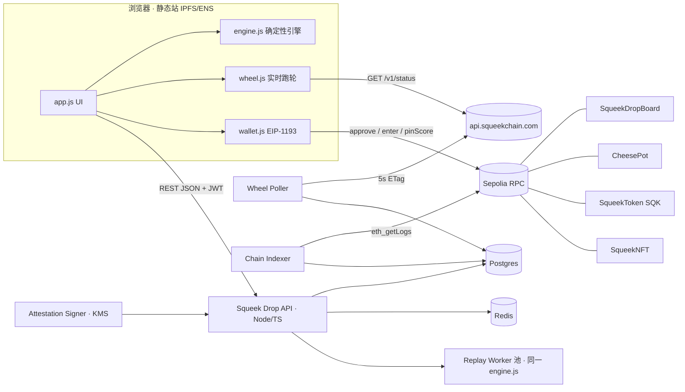

<callout icon="🛠️" color="blue_bg">
读者：后端 coding agent。范围：API 服务、回放验证、签名、索引器、两个 Sepolia 合约、部署。前端已完成（见总览页附件 `squeek-drop-frontend.zip`）。**凡本文与前端代码冲突，以 `js/engine.js` 和 `js/rules.js` 为准。** 规则版本 `sd-1.0.0`。
</callout>

## 1. 架构总览



| 组件 | 选型（建议） | 职责 |
| --- | --- | --- |
| API | Node 22 + TypeScript + Fastify | REST、鉴权、开局与结算、排行榜 |
| Replay Worker | `node:worker_threads` 池（CPU 数 −1） | 隔离 CPU 密集的回放 |
| DB | Postgres 16 | 用户、对局、成绩、天气快照、奶酪锅、上链记录 |
| Cache | Redis 7 | 排行榜 ZSET、限流、nonce、会话 |
| Wheel Poller | 独立进程 | 每 5 秒轮询 `/v1/status`，存快照、计算天气 |
| Indexer | 独立进程 + viem | 监听 `ScorePinned` / `Entered` / `Settled` 事件，确认数 12 |
| Signer | AWS KMS secp256k1 或本地 keystore（测试网） | EIP-712 签分数证明和奶酪锅结算 |
| 合约 | Solidity 0.8.26 + Foundry v1.8.3（与 IMD 验证器版本一致） | SqueekDropBoard、CheesePot |

## 2. 共享引擎（最重要）

### 2.1 原则

- 后端**直接 import 前端仓库里的 `js/engine.js` 和 `js/rules.js`**（ESM、零依赖、Node 可运行），不得重写或「移植」到其他语言。
- `RULES_VERSION` 是引擎行为指纹：任何会改变模拟结果的改动都必须升版本号（如 `sd-1.0.1`）。服务端对每个版本保留一份引擎快照：`engines/sd-1.0.0/engine.js`。
- 开局返回 `rulesVersion`；客户端版本不一致时前端会自动刷新（已实现）。

### 2.2 确定性保证

- 只用 IEEE-754 双精度的 `+ - * /`、`Math.sqrt`（结果按规范正确舍入，跨引擎一致）、`Math.floor/abs/min/max`、`Math.imul`；不用 `Math.sin`、`Math.hypot`、`Date`、`Math.random`。
- RNG：xorshift32，种子为 `FNV-1a(RULES_VERSION + '|' + seed)`。
- 迭代顺序固定（按数组顺序，即按 id 升序）；合并在碰撞之后统一处理，每个 tick 每个球最多合并一次。
- 计分是纯整数（基点 bps）。
- 实测：一局约 150 秒（8,967 tick、299 个输入）回放耗时约 90ms；30 分钟上限（108,000 tick）约 1.1 秒；输入日志约 4KB。

### 2.3 输入日志格式

```json
{ "inputs": [[0,0,212],[30,0,118],[44,1],[60,0,305],[61,2]], "endTick": 8967,
  "clientSummary": { "rulesVersion":"sd-1.0.0","score":2382,"ticks":8967,"merges":181,"maxLevel":10,"blocks":5,"over":true,"digest":"83665514" } }
```

- 元素格式为 `[tick, code, x?]`。code：`0`=DROP（x 为 0–400 的整数），`1`=SWAP，`2`=SHAKE。按 tick 非降序排列，同一 tick 可以有多条。
- `replay(cfg, inputs, endTick)` 返回 `{ok, reason?, summary}`。reason 有三种：`input_rejected`（违反冷却等规则）、`input_out_of_order`、`inputs_after_end`。

### 2.4 验证判定

```
ok = replay.ok
  && replay.summary.digest == clientSummary.digest
  && replay.summary.score  == clientSummary.score
  && endTick <= MAX_TICKS
  && (replay.summary.over || endTick == clientSummary.ticks)   // 主动结束也允许
```

- **以服务端回放分数为准**，客户端分数只用于比对。

## 3. 规则参数（服务端权威）

### 3.1 天气映射（与 `rules.js` 的 `weatherFromStatus` 一致）

```
s = { freshness, coreStatus, rpm = measurement.rpmMilli / 1000 }
if freshness != 'online' or coreStatus == 'COUNTER_FAULT' -> NAP
elif rpm >= 45                                            -> ZOOMIES
elif coreStatus == 'ACTIVE' or rpm >= 5                   -> JOG
else                                                      -> NAP
```

- `/v1/status` 返回 `builder.status = "unavailable"` 时，`blockStart = 0`，天气按 measurement 判断。如果 measurement 为 null，则为 NAP。
- 开局时取 Poller 最近一次快照，要求不超过 15 秒；超过就同步请求一次。快照 id 写入 run 记录，供审计。

### 3.2 种子

| 模式 | seed 字符串 | seasonId |
| --- | --- | --- |
| daily / holder | `daily:{YYYY-MM-DD}:{h8}` | `dayId` = YYYYMMDD（如 20261030） |
| pot | `pot:{week}:{h8}` | `week` = `floor((unix - 345600) / 604800)`，与合约 `currentWeek()` 一致；2026-10-26 至 11-01 这一周为 2964 |
| free | 客户端自生成，不入库 | — |

- `h8` = `keccak256(dayOrWeek ‖ 赛季开始前最后一个已结算轮次的 roundPage dataHash)` 的前 8 个 hex。赛季开始时计算一次并写入 `seasons` 表，**全体玩家相同**，同时也让种子和链上历史绑定。Mock 中省略了 h8，正式环境必须带上。
- `blockStart` = 快照的 `builder.projected.blockProgress`（没有就用 `anchor.blockProgress`），截断到 [0, 999,999,999]。

### 3.3 队长等级（持有者杯）

- 开局请求带 `captainTokenId`。服务端在 Sepolia 上 `eth_call` 调用 `SqueekNFT.ownerOf(tokenId)` 校验归属，等级从 Squeekchain API `/v1/squeeks/{tokenId}` 或 SqueekMining position 读取。等级在开局时锁定进 run。
- 同一 tokenId 在同一 season 内只能被一个地址使用（防止转手刷分）：表 `captain_locks(season, token_id) unique`。

## 4. 数据模型（Postgres）

```sql
create table users (
  address        citext primary key,           -- 0x 小写
  display_name   text,
  created_at     timestamptz default now(),
  banned         boolean default false
);
create table auth_nonces (
  nonce text primary key, address citext not null, message text not null,
  expires_at timestamptz not null, used boolean default false
);
create table wheel_snapshots (
  id bigserial primary key, fetched_at timestamptz not null,
  freshness text, core_status text, rpm_milli int, block_height bigint, block_progress bigint,
  settled_round bigint, weather text not null, raw jsonb not null, source text not null -- live|stale|unavailable
);
create table seasons (
  board smallint not null, season_id int not null, seed text not null,
  starts_at timestamptz not null, ends_at timestamptz not null, anchor_round bigint, anchor_data_hash text,
  primary key (board, season_id)
);
create table runs (
  run_id bytea primary key,                      -- 32 bytes, 随机
  address citext references users, mode text not null, board smallint not null, season_id int,
  seed text not null, weather text not null, block_start int not null, captain_token_id numeric, captain_level smallint default 0,
  rules_version text not null, snapshot_id bigint references wheel_snapshots,
  status text not null default 'started',        -- started|verified|rejected|expired
  started_at timestamptz default now(), finished_at timestamptz, expires_at timestamptz not null,
  end_tick int, score int, merges int, max_level smallint, blocks smallint, digest text,
  reject_reason text, inputs bytea                  -- zstd(JSON) 原样留存，便于复核
);
create index on runs (board, season_id, score desc) where status = 'verified';
create table best_scores (
  board smallint, season_id int, address citext, run_id bytea, score int, max_level smallint, weather text, at timestamptz,
  primary key (board, season_id, address)
);
create table pins (
  run_id bytea primary key references runs, address citext, tx_hash text, block_number bigint,
  status text default 'reported'                   -- reported|confirmed|failed
);
create table pot_entries (
  week int, address citext, tx_hash text, block_number bigint, primary key (week, address)
);
create table pot_settlements (week int primary key, winners text[], tx_hash text, settled_at timestamptz);
create table captain_locks (board smallint, season_id int, token_id numeric, address citext, primary key (board, season_id, token_id));
```

- 排行榜读取 Redis ZSET：`lb:{board}:{season}`（member=address, score=best），由 `best_scores` 写入时同步更新；历史总榜用 `lb:all`。

## 5. 鉴权（SIWE 简化版）

1. `POST /v1/auth/nonce {address}` → 生成 nonce（16 字节 hex，有效 5 分钟），返回 EIP-4361 格式的 message：

```
squeekdrop.xyz wants you to sign in with your Ethereum account:
0xabc…

Sign in to Squeek Drop. This does not send a transaction.

URI: https://squeekdrop.xyz
Version: 1
Chain ID: 11155111
Nonce: 9f3c…
Issued At: 2026-10-30T14:00:00Z
Expiration Time: 2026-10-30T14:05:00Z
```

2. `POST /v1/auth/verify {address, message, signature}` → 用 viem `verifyMessage` 校验 `personal_sign` 签名，并确认 nonce 未用过且未过期，然后签发 JWT（HS256，24 小时，`sub=address`）。不支持合约钱包（ERC-1271）也可以，但要返回 `400 unsupported_wallet`。
3. 每日杯、自由练习可以匿名开局：匿名 run 可以验证，但不进入排行榜，也不签发证明。前端在用户登录后可以重新开局。**建议：** daily 允许匿名游玩，结算时如果未登录，返回 `status=verified` 且不带 rank/attestation。

## 6. REST API 规范

- Base：`https://api.squeekdrop.xyz`，前缀 `/v1`，JSON，UTF-8。
- CORS：允许来源为生产域名、`*.eth.limo`、`*.ipfs.dweb.link`、`http://localhost:5173`。允许的请求头为 `authorization, content-type, x-request-id`。
- 每个响应都带 `x-request-id`，并回显客户端传入的值。
- 错误统一为 `{"error":"code","message":"…"}`。

### 6.1 `GET /v1/config`（公开）

```json
{ "chainId": 11155111, "rulesVersion": "sd-1.0.0",
  "contracts": { "board": "0x…", "pot": "0x…", "sqk": "0x6872bfa5ccc3e9e440c6c16e5ffdabb8dba4cc76", "nft": "0x0eAF3E0d40A0a8E5a6Ac030b2459E9FB0B7905c6" },
  "entryFeeBaseUnits": "10000000000000000000", "signer": "0x…" }
```

### 6.2 `POST /v1/auth/nonce`、`POST /v1/auth/verify`

见 §5。verify 返回 `{token, address, expiresAt}`。

### 6.3 `POST /v1/runs`（开局）

请求：`{ "mode": "daily"|"pot"|"holder", "captainTokenId": "17"|null, "clientRulesVersion": "sd-1.0.0" }`

- `pot`：必须已登录，且 `pot_entries` 中有本周记录（以 Indexer 确认为准；也可以实时 `eth_call` 调用 `CheesePot.entered(week, addr)` 兜底）。
- `holder`：必须已登录，并通过 §3.3 的校验。
- 限流：同一地址每分钟最多 6 次开局，同一时间最多 3 个 `started` 状态的 run。

响应 `201`：

```json
{ "runId": "0x…32bytes", "mode": "daily", "board": 1, "seasonId": 20261030,
  "seed": "daily:2026-10-30:3fa91c0e", "weather": "JOG", "blockStart": 734000000, "captainLevel": 0,
  "rulesVersion": "sd-1.0.0", "startedAt": "…", "expiresAt": "…(+40min)",
  "wheelSnapshot": { "rpm": 22.4, "coreStatus": "ACTIVE", "blockHeight": "2394", "blockProgress": 734000000, "simulated": false } }
```

错误：`401 auth_required`、`403 pot_not_entered`、`403 not_squeek_owner`、`409 captain_in_use`、`429 rate_limited`、`503 wheel_unavailable`（不应出现，因为会降级为 NAP）。

### 6.4 `POST /v1/runs/{runId}/finish`（结算）

请求：`{ inputs, endTick, clientSummary }`，见 §2.3。body 上限 256KB，inputs 最多 20,000 条。

处理流程：

1. 校验 run 属于当前用户（匿名 run 以 32 字节随机的 runId 本身作为凭证）、状态为 `started`、未过期。
2. **时间合理性：** `endTick / 60 ≤ (now − startedAt) + 15s`（不能比真实时间快）。
3. 投递到 Replay Worker（超时 5 秒）。
4. 判定（见 §2.4）。通过后在事务里写入 runs 和 best_scores，更新 ZSET。
5. 若刷新了个人最佳且 `board > 0`，签发证明（§7）。

响应 `200`：

```json
{ "runId": "0x…", "status": "verified", "reason": null, "score": 2382,
  "summary": { "score": 2382, "ticks": 8967, "merges": 181, "maxLevel": 10, "blocks": 5, "digest": "83665514" },
  "rank": 14, "personalBest": 2382, "isNewBest": true,
  "attestation": { "runId": "0x…", "board": 1, "season": 20261030, "score": 2382, "maxLevel": 10, "deadline": 1793460000, "signature": "0x…65bytes" } }
```

拒绝时返回 `status: "rejected"` 和 `reason`：`input_rejected`、`input_out_of_order`、`inputs_after_end`、`digest_mismatch`、`too_fast`、`expired`。HTTP 状态仍为 200，前端会展示 reason。

错误：`404 run_not_found`、`409 run_already_finished`、`413 payload_too_large`。

### 6.5 `POST /v1/runs/{runId}/pin`

请求 `{txHash}` → 写入 pins（status=reported），由 Indexer 确认后改为 confirmed。返回 `{ok:true}`。

### 6.6 `GET /v1/leaderboards/{board}?season=&limit=50`

- board 取 `daily | pot | holder | all`。season 默认是当前赛季。
- 带 JWT 时额外返回 `me`。

```json
{ "board": "daily", "season": 20261030,
  "entries": [ { "rank": 1, "address": "0x…", "name": "wheelwatcher.eth", "score": 6471, "maxLevel": 9, "weather": "ZOOMIES", "pinned": true, "you": false } ],
  "me": { "rank": 14, "score": 2382, "you": true, "address": "0x…", "maxLevel": 10, "weather": "JOG", "pinned": false } }
```

- 前端字段名必须完全一致：`rank, address, name, score, maxLevel, weather, pinned, you`。name 可以为 null，此时前端会显示缩写地址；有条件的话后端可以做 ENS 反查。

### 6.7 `GET /v1/me`

返回 `{address, displayName, bests: {"1:20261030": {score, maxLevel, weather, runId}}, runs: n}`。

### 6.8 `GET /v1/holder/squeeks`（需登录）

- 代理 Squeekchain 的 `GET /v1/owners/{address}/squeeks`（分页取完）。返回 `{items:[{tokenId, level, power}]}`；也可以附带 `image`（来自 `/v1/squeeks/{id}`）。
- 只用于展示，开局时会重新在链上校验。

### 6.9 `GET /v1/pot/current`

```json
{ "week": 2964, "weekLabel": "2026-W44", "entryFeeBaseUnits": "10000000000000000000",
  "potBaseUnits": "380000000000000000000", "entrants": 38, "endsAt": "2026-11-02T00:00:00Z",
  "entered": true, "payoutBps": [5000, 3000, 2000] }
```

- `potBaseUnits` 读取合约 `pots(week)`，`entered` 读取 `entered(week, me)`。

## 7. 分数证明（EIP-712）

```
domain = { name: "SqueekDrop", version: "1", chainId: 11155111, verifyingContract: <SqueekDropBoard> }
ScoreAttestation(bytes32 runId,address player,uint8 board,uint32 season,uint64 score,uint8 maxLevel,uint64 deadline)
```

- `player` = run 的地址，合约里用 `msg.sender` 代入，所以别人拿到签名也无法替你上链。
- `deadline` = 当前时间 + 24 小时。
- 前端调用：`pinScore(bytes32 runId, uint8 board, uint32 season, uint64 score, uint8 maxLevel, uint64 deadline, bytes signature)`，签名为 65 字节 r‖s‖v。
- Signer 私钥只在 Signer 服务中使用（KMS），API 通过内网 RPC 请求签名。

## 8. 合约规范（Sepolia）

### 8.1 SqueekDropBoard

```solidity
// SPDX-License-Identifier: MIT
pragma solidity 0.8.26;
interface ISqueekDropBoard {
  event ScorePinned(address indexed player, uint8 indexed board, uint32 indexed season, bytes32 runId, uint64 score, uint8 maxLevel);
  event SignerChanged(address oldSigner, address newSigner);
  error Expired(); error BadSignature(); error AlreadyPinned(); error NotHigher();
  function pinScore(bytes32 runId, uint8 board, uint32 season, uint64 score, uint8 maxLevel, uint64 deadline, bytes calldata sig) external;
  function best(uint8 board, uint32 season, address player) external view returns (uint64 score, bytes32 runId);
  function pinned(bytes32 runId) external view returns (bool);
  function signer() external view returns (address);
  function setSigner(address) external; // onlyOwner (Ownable2Step)，仅用于密钥轮换
}
```

规则：
- `block.timestamp ≤ deadline`；`runId` 不能重复；`score` 必须大于 `best[board][season][msg.sender]`，否则 revert `NotHigher`，这样链上只保留最好成绩。
- 用 OpenZeppelin `EIP712` + `ECDSA.recover`（拒绝 malleable s）。
- 无资金、无 upgrade。

### 8.2 CheesePot

```solidity
interface ICheesePot {
  event Entered(uint32 indexed week, address indexed player, uint256 fee);
  event Settled(uint32 indexed week, address[3] winners, uint256[3] amounts, uint256 rolledOver);
  error WrongWeek(); error AlreadyEntered(); error NotEnded(); error AlreadySettled(); error BadSignature();
  function SQK() external view returns (address);          // 0x6872…cc76, immutable
  function ENTRY_FEE() external view returns (uint256);    // 10e18, immutable
  function currentWeek() external view returns (uint32);   // (block.timestamp - 345600) / 604800
  function enter(uint32 week) external;                     // week == currentWeek(); SQK.transferFrom(msg.sender, this, ENTRY_FEE)
  function entered(uint32 week, address) external view returns (bool);
  function pots(uint32 week) external view returns (uint256);
  function settle(uint32 week, address[3] calldata winners, bytes calldata sig) external; // 任何人可调用，需 signer 签名
}
```

- 结算签名：EIP-712 `Settlement(uint32 week,address[3] winners)`，domain 的 name 为 `CheesePot`。
- 前提是 `week < currentWeek()`。分成 5000/3000/2000 bps。winner 为 `address(0)`，或该地址未报名时，对应份额滚入 `pots[week+1]`；四舍五入的尘埃也滚入下周。
- 使用 `SafeERC20`；ReentrancyGuard；无 owner 提款函数（资金只能流向赢家或下一周）。
- 后端每周一 00:05 UTC 读取 `best_scores(board=2, season=week)` 的前三名（必须在 `pot_entries` 中，且 run 为 verified），签名后由 keeper 账户调用 `settle`。

### 8.3 Foundry 测试（必须）

- Board：签名正确、过期、重放、换人提交（msg.sender ≠ player）、NotHigher、setSigner 权限。
- Pot：报名扣费、重复报名、错周、未到期结算、错签名、不足 3 人滚存、fuzz 金额守恒（`sum(payout) + rolled == pot`）。
- 部署脚本 `script/Deploy.s.sol`：输出地址到 `deployments/sepolia.json`，前端通过 `/v1/config` 读取。

## 9. Wheel Poller

- 每 5 秒请求 `GET https://api.squeekchain.com/v1/status`，带 `If-None-Match`。收到 304 时只更新 fetched_at。
- 校验 `schemaVersion == 1`，否则告警并保持 last-good。遇到 429 或 503 时按 `Retry-After` 退避。
- 写入 wheel_snapshots，保留 30 天。同时写 Redis `wheel:last`，供开局读取。
- 对外可以选择提供 `GET /v1/wheel`（直接返回 last snapshot + weather），前端目前直接读取官方 API 做展示，权威天气以开局响应为准。

## 10. Chain Indexer

- viem 的 `getLogs` 每 12 秒拉一次，确认数 12（与 Squeekchain API 的口径一致），断点存在 `indexer_cursor` 表。
- 事件处理：`ScorePinned` → pins.confirmed，排行榜上标 pinned；`Entered` → pot_entries；`Settled` → pot_settlements。
- 遇到重组时回滚到 cursor − 64 并重放（幂等 upsert）。

## 11. 反作弊

| 风险 | 对策 |
| --- | --- |
| 伪造分数 | 服务端回放为唯一事实来源，并比对 digest |
| 加速或离线预计算 | 规则「tick 时长不超过真实耗时 + 15 秒」；run 40 分钟过期 |
| 篡改天气或起点 | 天气、blockStart、种子都由服务端下发，并写入 run，客户端传入无效 |
| 每日种子公开后被脚本搜索最优解 | 只允许真实时间回放（见上）；输入间隔熵检测（标准差过低就标记）；单日开局上限 200 次；人工复核前 10 名的 inputs（已留存）；奖池仅限测试网 |
| 多号刷奶酪锅 | 每个地址需要自付报名费；同一 Squeek 每赛季锁定一个地址 |
| 签名重放 | runId 唯一，deadline 有限，player = msg.sender |

## 12. 配置与环境变量

```
PORT=8080
DATABASE_URL=postgres://…
REDIS_URL=redis://…
JWT_SECRET=…
CORS_ORIGINS=https://squeekdrop.xyz,https://*.eth.limo,http://localhost:5173
SEPOLIA_RPC_URL=…            # 支持历史状态
SQUEEK_API=https://api.squeekchain.com
SQK_ADDRESS=0x6872bfa5ccc3e9e440c6c16e5ffdabb8dba4cc76
NFT_ADDRESS=0x0eAF3E0d40A0a8E5a6Ac030b2459E9FB0B7905c6
CORE_ADDRESS=0x74665dAecA35A2303e767E76a2FF1FB6F93e119f
BOARD_ADDRESS=…  POT_ADDRESS=…
SIGNER_KMS_KEY_ID=…  (或 SIGNER_PRIVATE_KEY 仅限本地)
KEEPER_PRIVATE_KEY=…         # 只用于 settle，余额保持很少
RULES_VERSIONS=sd-1.0.0
```

## 13. 部署与 IMD 归属（徽章关键）

1. 代码放到公开的 GitHub 仓库：`/web`（前端原样）、`/server`、`/contracts`。
2. 用 Genesis 资料中**已验证的钱包**（普通 EOA，不能是合约钱包）支付 IMD 的第一笔订单。推荐用 `workflow.open`：合约在 Sepolia 上构建、测试、审查并部署，然后基于部署地址构建网站并 pin 到 IPFS / ENS。可以先用 `POST /requests/import`（kind=`site` 或 `contracts`）导入仓库，再用 `POST /requests/check` 预检。
3. 后续迭代一律使用 `job.continue`，并且由同一个钱包付款（不同钱包付款会被拒绝，费用也不退）。
4. API 服务自托管（Fly.io / Railway 均可），前端通过 `window.SQUEEK_DROP_CONFIG.apiBase` 指向它。
5. 如果使用自有域名，需要保留 DNS 验证记录：官方每天复检，记录被删除会导致徽章失效。

## 14. 测试计划

- **引擎：** `npm test`（已有，覆盖三种天气 × 两种机器人回放一致、篡改检测、冷却违规）。后端 CI 需要在 Node 和至少一个其他 JS 引擎（Bun 或 Deno）上跑一遍，确认 digest 跨引擎一致。
- **API：** 契约测试，用前端 Mock 的返回结构做 JSON Schema 快照比对。
- **E2E：** Playwright 驱动前端，使用 `?api=http://localhost:8080` 加 anvil fork Sepolia，跑通开局 → 结算 → pinScore → 排行榜显示已上链。
- **压测：** 每秒 50 次结算，P95 < 800ms。

## 15. 监控与告警

- 指标：回放耗时、拒绝率（按 reason 分）、Squeekchain API 失败率、Indexer 延迟（区块）、Signer 调用次数、Keeper 余额。
- 告警：拒绝率 > 3%（可能引擎版本不一致）；Poller 连续 2 分钟失败；Indexer 落后 > 100 块。
