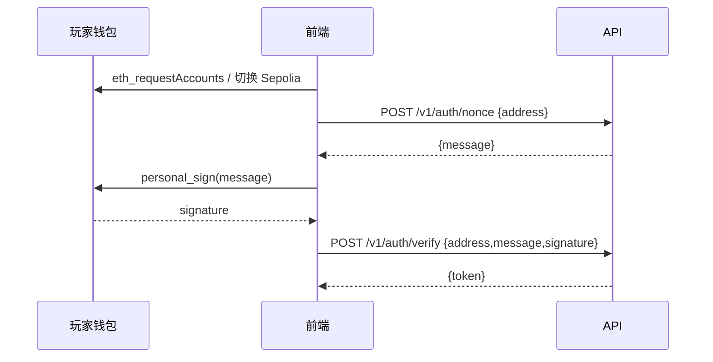
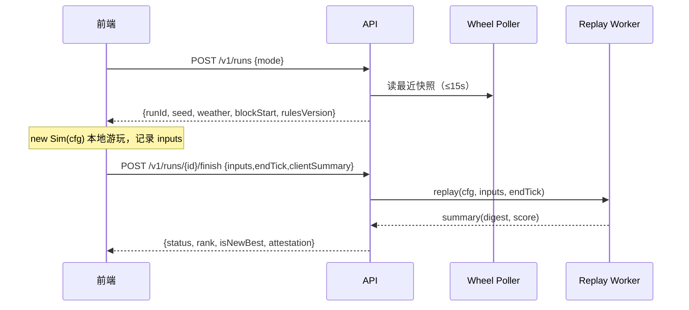
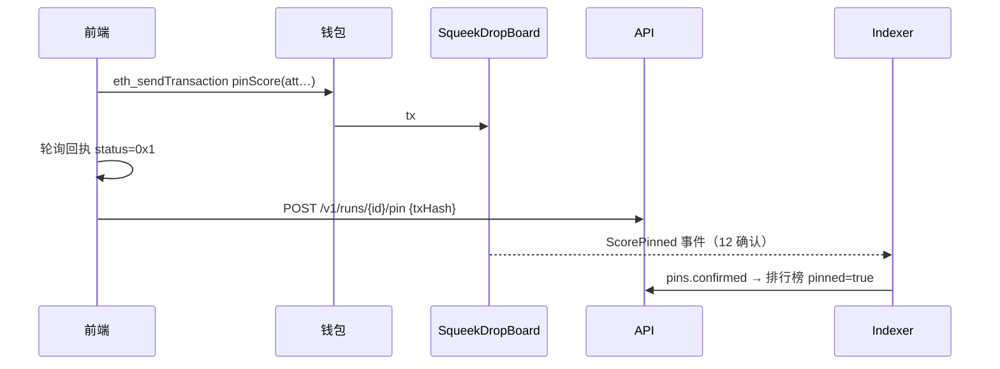
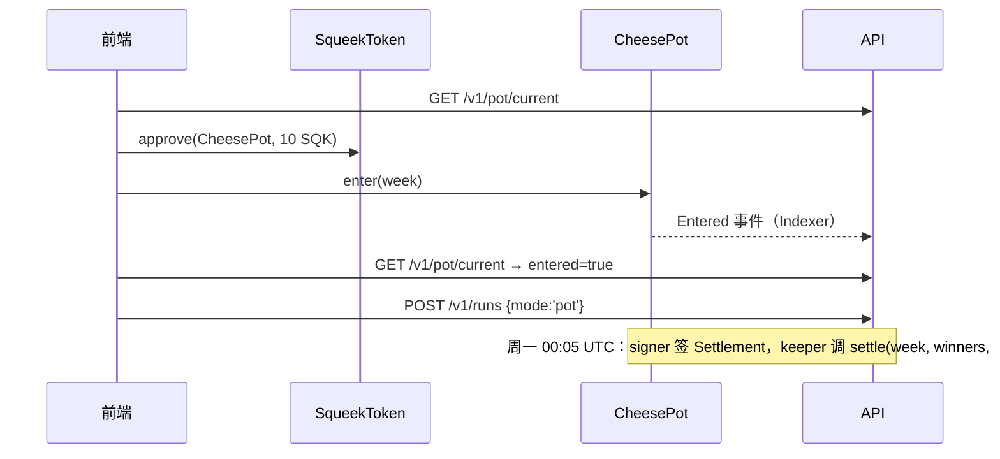

<callout icon="🔗" color="green_bg">
这份文档是前后端的**接口契约 + 联调手册**。前端已按本文实现，并在 `js/api.js` 中提供了结构完全一致的 `MockApi`。后端只要让真实接口返回同样的结构，前端不需要改代码就能切换。
</callout>

## 1. 仓库结构（建议的 monorepo）

```
squeek-drop/
├─ web/                 ← 前端成品原样放入（总览页附件 zip）
│  ├─ index.html  css/style.css
│  └─ js/ engine.js rules.js render.js app.js api.js wallet.js wheel.js i18n.js audio.js config.js
├─ server/              ← 后端：import '../web/js/engine.js' 和 '../web/js/rules.js'
├─ contracts/           ← Foundry：SqueekDropBoard.sol  CheesePot.sol
└─ tests/engine.test.mjs
```

**红线：** `web/js/engine.js` 和 `web/js/rules.js` 是前后端共用的唯一事实来源。后端不得复制修改；如需改动，必须同时升级 `RULES_VERSION`，并保留旧版本引擎用于回放历史对局。

## 2. 前端如何切换到真实后端

| 方式 | 用法 | 场景 |
| --- | --- | --- |
| URL 参数 | `?api=http://localhost:8080` | 本地联调 |
| 全局配置 | 在 `js/app.js` 之前插入 `<script>window.SQUEEK_DROP_CONFIG={apiBase:'https://api.squeekdrop.xyz'}</script>` | 生产部署 |
| 强制 Mock | `?mock=1` | 后端没起来时演示 |

- `apiBase` 为空时自动使用 Mock，右上角显示「Demo mode」。
- 合约地址启动时从 `GET /v1/config` 的 `contracts.board / contracts.pot` 读取，也可以写进 `SQUEEK_DROP_CONFIG.board / .pot`。
- 前端 JWT 存在 `sessionStorage['sd.jwt']`，请求时带 `Authorization: Bearer`。每个请求都带 `x-request-id: sd-xxxxxxxxxx`。

## 3. 前端调用点 ↔ 接口对照

| 前端函数（js/api.js） | HTTP | 前端读取的字段 | 触发位置 |
| --- | --- | --- | --- |
| `config()` | GET /v1/config | `contracts.board`, `contracts.pot` | 启动 |
| `login(address, sign)` | POST /v1/auth/nonce → POST /v1/auth/verify | nonce 接口返回 `message`；verify 接口返回 `token` | 点击「连接钱包」 |
| `startRun(mode, {captainTokenId})` | POST /v1/runs | `runId, seed, weather, blockStart, captainLevel, rulesVersion` | 选择模式（free 除外） |
| `finishRun(runId, {inputs,endTick,clientSummary})` | POST /v1/runs/{id}/finish | `status, reason, rank, isNewBest, attestation.{runId,board,season,score,maxLevel,deadline,signature}` | 本局结束 |
| `reportPin(runId, txHash)` | POST /v1/runs/{id}/pin | — | pinScore 交易成功后 |
| `leaderboard(board)` | GET /v1/leaderboards/{board} | `entries[].{rank,address,name,score,maxLevel,weather,pinned,you}` | 排行榜页、对局右侧迷你榜 |
| `holderSqueeks()` | GET /v1/holder/squeeks | `items[].{tokenId,level}` | 持有者杯选队长 |
| `pot()` | GET /v1/pot/current | `week, weekLabel, entryFeeBaseUnits, potBaseUnits, entrants, endsAt, entered` | 奶酪锅弹窗 |

前端处理的错误码：`auth_required`（引导连接钱包）、`pot_not_entered`、`not_squeek_owner`、`captain_in_use`、`rate_limited`、`run_already_finished`。其余错误码原样以 toast 展示。拒绝原因（`reason`）直接显示在结算弹窗里。

## 4. 前端直接发起的链上调用（js/wallet.js）

| 动作 | 合约 | 函数签名 | 选择器来源 |
| --- | --- | --- | --- |
| 查询 SQK 余额 | SqueekToken | `balanceOf(address)` | 内置 keccak256 运行时计算 |
| 查询授权额度 | SqueekToken | `allowance(address,address)` | 同上 |
| 授权报名费 | SqueekToken | `approve(address,uint256)`（spender = CheesePot，amount = entryFeeBaseUnits） | 0x095ea7b3（已测试） |
| 报名 | CheesePot | `enter(uint32)`（参数取 `/v1/pot/current` 的 `week`） | 运行时计算 |
| 分数上链 | SqueekDropBoard | `pinScore(bytes32,uint8,uint32,uint64,uint8,uint64,bytes)` | 运行时计算 |

- 合约函数签名**必须与上表完全一致**，否则选择器对不上。改签名就要同步修改 `wallet.js` 中的 `chainCalls`。
- 前端会自动请求切换到 Sepolia（`0xaa36a7`），没有添加过的话自动执行 `wallet_addEthereumChain`。
- 交易回执通过 `eth_getTransactionReceipt` 轮询（2.5 秒一次，最长 120 秒），`status != 0x1` 视为失败。

## 5. 关键时序

### 5.1 登录



### 5.2 对局与验证



### 5.3 上链存证



### 5.4 奶酪锅



## 6. 联调用例（按顺序跑）

| # | 用例 | 预期 |
| --- | --- | --- |
| 1 | `npm test`（前端仓库） | 输出 all engine tests passed |
| 2 | 后端用同一引擎回放 `tests/fixtures/*.json`（从前端导出的对局） | digest 完全一致 |
| 3 | 打开 `?api=http://localhost:8080`，确认右上角 Demo 标签消失 | `/v1/config` 200 |
| 4 | 连接钱包，完成登录 | 按钮显示缩写地址，sessionStorage 中有 sd.jwt |
| 5 | 开始每日杯，同一天换另一个钱包再开一局 | 两局的 seed 相同、队列前 10 个相同 |
| 6 | 正常打完一局 | 返回 verified，rank 和 isNewBest 正确，attestation 签名能被合约验过 |
| 7 | 在 DevTools 里修改 `inputs[5][2]` 后提交（可以用 `fetch` 重放） | 返回 rejected 和 digest_mismatch（或 input_rejected） |
| 8 | 两次提交同一个 runId | 返回 409 run_already_finished |
| 9 | 只玩 10 秒，却伪造 endTick = 36,000 | 返回 rejected 和 too_fast |
| 10 | 点击「Pin score on Sepolia」 | 弹出交易链接 toast，Etherscan 可查到，约 3 分钟后排行榜显示已上链 |
| 11 | 用旧分数再次 pin（不是更高的分数） | 合约 revert NotHigher；不应出现这种情况，因为前端只在新纪录时显示按钮 |
| 12 | 奶酪锅：approve → enter | 两笔交易成功，弹窗切换成「本周已报名」和开始按钮 |
| 13 | 未报名直接 POST /v1/runs {mode:'pot'} | 返回 403 pot_not_entered |
| 14 | 持有者杯：用不持有 Squeek 的钱包 | 列表为空并给出提示；硬塞 tokenId 时返回 403 not_squeek_owner |
| 15 | 断开 api.squeekchain.com（hosts 屏蔽） | 前端显示 SIM 并说明是模拟数据；开局天气为 NAP，blockStart 来自 last-good 或 0 |
| 16 | 移动端 390×844 | 画布、队列和道具在一屏内，无横向滚动 |

## 7. 提交与拿徽章流程（Checklist）

1. 在 `squeekchain.com/genesis/me` 加入 Genesis，绑定 X，并**验证一个普通 EOA 钱包**。
2. 把仓库推到公开 GitHub。
3. 用这个钱包在 `explorer.imd.fun/launch` 支付 0.5 IMD，开启项目的**第一个 job**（推荐 workflow.open：合约 + 网站）。在需求描述里写明：基于现有仓库，部署 SqueekDropBoard 和 CheesePot 到 Sepolia，网站使用 `/web`。
4. job 完成后拿到 IPFS / ENS 站点，填好 API 地址后自测第 6 节全部用例。
5. 在 Genesis 资料页确认项目显示为 Verified，等待团队审核（通过后获得 The Buildooooor）。
6. 用自己的钱包完成一次奶酪锅 approve，即可获得 The Tester。
7. Swarm Review 开放后申请 Squeek of Approval。每个版本可以评审一次，迭代都用 `job.continue`。

## 8. 后端待办（交给 coding agent）

- [ ] server：§6 的全部接口、Replay Worker 池、JWT、限流
- [ ] Wheel Poller 和 seasons 表的生成（每日 00:00 UTC、每周一 00:00 UTC）
- [ ] Signer 服务（EIP-712 ScoreAttestation 和 Settlement）
- [ ] 合约 SqueekDropBoard 和 CheesePot，Foundry 测试，部署脚本
- [ ] Indexer（ScorePinned / Entered / Settled）
- [ ] 奶酪锅周结算 keeper 任务
- [ ] 跨引擎 digest 一致性 CI
- [ ] 生产部署时在 `index.html` 注入 `SQUEEK_DROP_CONFIG`
